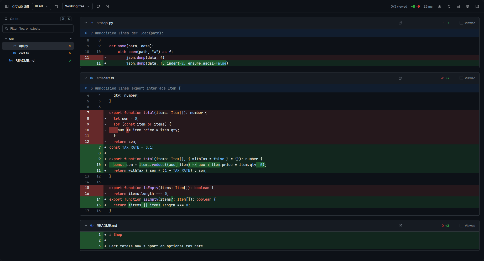
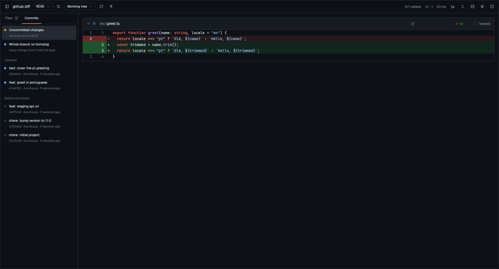

# github-diff para o Herdr

Um visualizador de diff para o [Herdr app](https://herdr.dev) com a cara da aba **Files changed** do GitHub: a árvore de arquivos à esquerda e o diff de **todos os arquivos um embaixo do outro**, cada um no seu cartão, numa rolagem só. Abre numa janela grande por cima do Herdr e, por padrão, mostra o que ainda **não foi commitado**, o jeito mais rápido de revisar o que o agente acabou de escrever.



## O que ele faz

- **Todos os arquivos numa rolagem só**, cada um num cartão com borda e cantos arredondados, como no GitHub. O cabeçalho do arquivo atual fica preso no topo enquanto você rola.
- **Começa no que não foi commitado** (`HEAD` → `Working tree`), com os arquivos novos inclusos. Sem nada a commitar, mostra a branch inteira como uma PR, contra a branch de onde ela saiu (`homolog` ou `develop` num repo que integra lá, senão `main`). Pelo seletor de base no topo você troca entre os dois.
- **Cores e fonte do GitHub**: verde e vermelho do GitHub nas linhas, as palavras que mudaram em destaque, sintaxe colorida com a paleta do GitHub, tema claro ou escuro conforme o Herdr. O código usa uma fonte monoespaçada sem ligaduras (`===` e `=>` aparecem como foram digitados).
- **Aba Commits** na lateral (`c` alterna com a aba Files): **Uncommitted changes**, **Whole branch vs homolog** (tudo desde que a branch saiu da base, como uma PR) e os últimos 40 commits da worktree. Os commits da própria branch têm um ponto azul, e uma linha marca onde a branch começou. Clique num commit para ver só o diff dele; o ✕ no chip do commit, no topo, volta para o que não foi commitado. Quando o agente commita, a lista se atualiza sozinha.

  
- **Unified por padrão**, como no GitHub; um botão na barra troca para split (lado a lado).
- **Marcar como visto** (`v`): o arquivo recolhe e volta sozinho se mudar de novo.
- **Comentários nas linhas** (clique no número da linha) e **Send to agent**, que manda todos para o agente que está trabalhando naquela branch dentro do Herdr.
- **Atualiza sozinho** a cada 2 segundos enquanto o agente edita.
- Busca de arquivos (`ctrl-k`), busca no diff (`ctrl-f`), abrir o arquivo no editor (`o`, VS Code por padrão).

## Instalação

Precisa do **Herdr app** (a versão desktop) e do `git`. O `gh` (GitHub CLI) é opcional: só é usado para ver pull requests.

> O repositório é privado: para instalar, você precisa ter acesso a ele.

### Pelo script

```sh
gh repo clone dias-oblivion/herdr-github-diff
cd herdr-github-diff
sh install.sh
```

O script copia o mod para `~/.config/herdr-app/mods/github-diff`, confere se ele carrega (`herdr-app check`) e cria o atalho **`ctrl-shift-d`** (**`cmd-shift-d`** no macOS). Se você já usa essa tecla para outra coisa, ele não mexe e avisa. Para atualizar depois, é só `git pull` e rodar o `install.sh` de novo.

### Pelo agente do Herdr

Dentro do Herdr, peça para o Claude Code (ou outro agente):

```
Read ~/.config/herdr-app/AGENTS.md, then add this mod: github.com/dias-oblivion/herdr-github-diff
```

### Na mão

1. Copie a pasta `mods/github-diff` para `~/.config/herdr-app/mods/`.
2. Em `~/.config/herdr-app/keys.json`, na seção `"global"`, adicione `"ctrl-shift-d": "mod.open:github-diff"` (no macOS, `cmd-shift-d`).
3. Rode `herdr-app check ~/.config/herdr-app/mods/github-diff`.

## Como usar

Foque um terminal que esteja dentro de um repositório git (pode ser uma worktree) e aperte **`ctrl-shift-d`**. O diff mostra o repositório do terminal em foco.

| Tecla | O que faz |
|---|---|
| `j` / `k` | próximo / anterior arquivo |
| `n` | próximo arquivo ainda não visto |
| `v` | marca como visto (e recolhe) |
| `x` | recolhe / expande o arquivo |
| `o` | abre o arquivo no editor |
| `ctrl-k` | ir para arquivo, commit ou PR |
| `ctrl-f` | buscar texto no diff |
| `c` | alterna entre as abas Files e Commits |
| `ctrl-b` | mostrar / esconder a barra lateral |
| `?` | configurações (unified/split, editor, arquivos inteiros) |
| `esc` ou ✕ | fecha (o ✕ fica no canto direito da barra superior) |

No macOS, use `cmd` no lugar de `ctrl`.

## Opcional: fazer o botão "Changes" abrir o github-diff

O botão **Changes** no canto superior direito faz parte da barra de abas do próprio Herdr e abre o painel lateral. Para ele abrir o github-diff, você usa uma cópia sua da barra (a cópia não recebe as atualizações que o Herdr fizer na barra original):

1. Clone a barra de abas: `herdr-app do mod.clone '{"name":"tabs","as":"tabs-diff"}'`
2. Em `~/.config/herdr-app/mods/tabs-diff/main.js`, troque a linha que contém `panelButton("changes", "Changes", "mods/changes/changes.svg")` por:
   ```js
   .when(enabled.includes("changes"), el => el.child(h_flex().id("panel-changes").h(26).px(8).gap(5).flex_none().items_center().rounded(6)
     .text_size(12).bg(t.chrome).text_color(t.muted).hover(s => s.bg(t.hover)).on_mouse_down("left", stop)
     .on_click(() => run("mod.open", { name: "github-diff" }))
     .child(svg("mods/changes/changes.svg").size(14)).child("Changes")))
   ```
3. No seu layout, troque `"mod": "tabs"` por `"mod": "tabs-diff"`. Os layouts que vêm com o Herdr são só leitura: se você usa o `main`, clone ele antes com `herdr-app do layout.clone '{"name":"main","as":"main-diff"}'` (o Herdr já troca para o clone) e edite `~/.config/herdr-app/layouts/main-diff.json`.

Ou peça ao agente do Herdr: *"Make the Changes button in the tab bar open the github-diff mod instead of the side panel: clone the tabs mod and use the clone in my layout."*

## Diferenças em relação ao snappy-diff

Este mod é um fork do [snappy-diff](https://github.com/duartecaldascardoso/caldas-stack/tree/main/snappy-diff), de Duarte Cardoso. O que mudou:

- Visual do GitHub: um cartão por arquivo, com espaço entre eles; paleta de diff e de sintaxe do GitHub (Primer), clara e escura; fonte maior (13.5px, linha de 22px) e sem ligaduras.
- Por padrão mostra só o que não foi commitado (o original compara com o ponto em que a branch saiu da `main`).
- A base da branch é a que ela deixou por último entre a `origin/HEAD` e os alvos comuns (`homolog`, `develop`, `main`, `master`), e não só a `origin/HEAD`. Num repo cuja `origin/HEAD` é a `main`, mas que recebe as PRs na `homolog`, a comparação não traz os commits que a `main` ainda não tem.
- Unified por padrão, VS Code como editor padrão.
- Atalhos com `ctrl` no Linux e no Windows (o original só aceitava `cmd`).
- Nome próprio (`github-diff`): pode ser instalado junto com o snappy-diff original sem conflito.

## O que ele acessa

Roda `git` no repositório em foco (só leitura, sem travar o índice). Guarda preferências, arquivos vistos e comentários em `~/.config/herdr-app/data/github-diff/`. Fala com o GitHub só pelo `gh`, com a sua conta: para achar a PR da branch (quando não há nada pendente), listar PRs no `ctrl-k`, buscar uma PR que você abrir (um `git fetch` dela) e postar comentários quando você clicar para isso.

## Licença

MIT. Veja [LICENSE](LICENSE). Baseado no snappy-diff © 2026 Duarte Cardoso.
