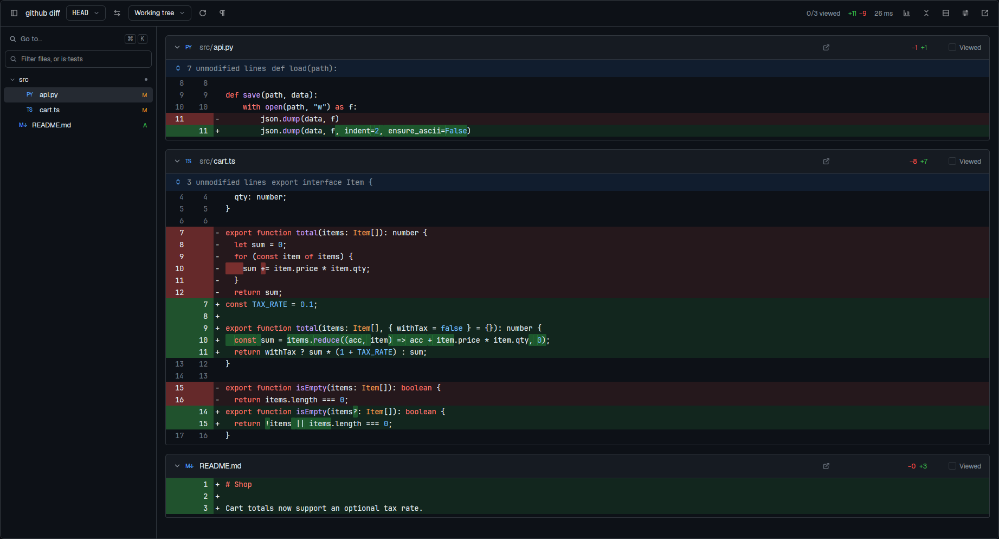

# github-diff

A GitHub-style diff viewer that opens over the Herdr window: a file tree on the left and every changed file in one scrolling list, each file in its own rounded, bordered card like GitHub's **Files changed** tab. It starts on the uncommitted work of the focused terminal's repository, in GitHub's colors and a ligature-free monospace font. A fork of [snappy-diff](https://github.com/duartecaldascardoso/caldas-stack/tree/main/snappy-diff) by Duarte Cardoso (MIT).

## What you see

A modal dialog, 96% of the window wide and 92% tall. Colors are GitHub's Primer palette laid over the Herdr theme: dark (`#0d1117` canvas, `#161b22` headers, `#30363d` borders, `#e6edf3` text) or light (`#ffffff`, `#f6f8fa`, `#d0d7de`, `#1f2328`), picked by the lightness of the theme's `background`. UI text 13px in the UI font; code 13.5px in the first installed of JetBrains Mono NL, SF Mono, Menlo, Consolas, Liberation Mono, DejaVu Sans Mono (else the terminal font), 22px lines.

- **Toolbar** (48px, bottom border): sidebar toggle, "github diff" in 14px semibold, the base picker (`HEAD` when there is uncommitted work), a swap button, the head picker ("Working tree"), a commit picker when the range has several, reload and an ignore-whitespace toggle. On the right: `viewed/total viewed`, `+added` green and `−removed` red, the load time, **Send to agent (n)** with copy and clear once there are comments, an overview chart, collapse/expand all, unified/split, settings and pop-out.
- **Sidebar** (288px, toggled with `ctrl-b`): "Go to…", a filter field ("Filter files, or is:tests"), then the file tree: folders first, single-child folders folded, a two-letter type badge, the name and a status letter (A green, M yellow, D red). The file at the top of the diff is highlighted.
- **Diff**: one virtual list. Each file is a card 16px in from both sides, 16px apart, 1px border, 6px corners: a 44px header on the subtle background (chevron, badge, folder in muted and name, tags, open-in-editor, comment count, `−del +add`, a **Viewed** checkbox), then its rows, then a 7px foot that closes the card. A collapsed file is just its header, rounded all round.
- **Lines**, unified by default (split in settings or the toolbar): old and new line numbers, a `+`/`-` column, the code wrapped at word boundaries. Added lines `#2ea04326` with `#3fb9504d` numbers and `#2ea04366` changed words; removed lines `#f851491a`, `#f851494d`, `#f8514966` (light: `#e6ffec`/`#ccffd8`/`#abf2bc` and `#ffebe9`/`#ffd7d5`/`#ff818266`). In split, a side with no line is the plain subtle background. Syntax: keywords `#ff7b72`, strings `#a5d6ff`, numbers and constants `#79c0ff`, functions `#d2a8ff`, types `#ffa657`, comments `#8b949e` (light: `#cf222e`, `#0a3069`, `#0550ae`, `#8250df`, `#953800`, `#6e7781`).
- **Separators** (32px, GitHub's hunk blue `#388bfd1a`): a blue expand icon, `N unmodified lines` and the hunk's function context.
- **Pinned header:** once a file's header scrolls away, a copy pins to the top of the diff inside the card's margins, with a shadow.
- **Comments** sit under the last line they cover, as cards with Edit and Delete.

## How it behaves

- **What it shows first:** the focused terminal's repository. With uncommitted work, the working tree against `HEAD` (staged, unstaged and untracked files). With none, the current branch like a pull request, against the branch it forked from most recently among `origin/HEAD`'s and the usual targets (`origin/homolog`, `origin/develop`, `origin/main`, `origin/master`, `main`, `master`; a tie keeps `origin/HEAD`'s), and the branch's pull request base when `gh pr view` finds one. The base and head pickers change either.
- **Live:** the working tree is diffed again every 2 seconds; only changed files redraw.
- **Keys:** `j`/`k` next and previous file, `n` next unviewed, `v` viewed (collapses; clears itself when the file changes), `x` collapse, `o` open in the editor at the first change (VS Code by default; Zed and Cursor in settings), `/` filter, `ctrl-b` sidebar, `ctrl-k` go to (files, commits, pull requests, actions), `ctrl-f` search lines, `?` settings, `t` reopen in a tab, `esc` closes what's open, else the dialog. `cmd` works in place of `ctrl` on macOS.
- **Comments:** click a line number, shift-click to extend, enter saves. **Send to agent** types a numbered prompt (`path:line`, the code, the comment) into the Herdr agent working on that repository or branch; copy puts it on the clipboard. On a pull request, `GitHub (n)` posts them as one review.
- Preferences, viewed marks and comments are saved in `~/.config/herdr-app/data/github-diff/`.

## Built from

- `mods/github-diff/mod.json`: `place: "none"`, `focusable: true`, overlay `{ kind: "dialog", modal: true, width: 0.96, height: 0.92 }`. `keys.json` binds `ctrl-shift-d` and `cmd-shift-d` to `mod.open:github-diff`.
- snappy-diff's modules, unchanged: `patch.js`, `words.js`, `syntax.js`, `rows.js`, `tree.js`, `moved.js`, `insights.js`, `review.js`, `git.js` (`git` with `--no-optional-locks` and fsmonitor off; `gh` for pull requests).
- `store.js`: JSON under `appHome()/data/github-diff`; default prefs `{ diffStyle: "unified", editor: "vscode" }`.
- `main.js` changes from snappy-diff: `GH` palettes and `github(t)`, which overlays them on `theme()`; `rebuild()` emits `gap`, `file` (`last` when collapsed), rows and `foot` items; `renderItem()` wraps every non-gap item in the card (side borders, top border and `rounded_t` on the header, bottom border and `rounded_b` on the foot or a collapsed header) and `renderCardItem()` draws what's inside; `metrics()` uses the card's inner width; `clickRow()` measures from the card's inner edges (`INSET` = margin + border); `start()` picks `HEAD` as the base when the tree is dirty; `onKey()` maps `ctrl-b/k/f` to the `cmd-` actions; `codeFont()` picks the font from `fonts()`. In `git.js`, `defaultBase()` measures `rev-list --count <candidate>..HEAD` for each candidate base and keeps the smallest.

## Watch out

- Rows of a virtual list can't have handlers: clicks are resolved by position, so the header's fixed-width parts, the gutter width and the card inset must stay in step with `clickRow()`.
- Item heights are computed up front: a card header is `HEADER_H` + 1 (+ 1 more when collapsed) because the card's borders take that room; rows are `wrapped lines × LINE_H`.
- GPUI doesn't clip children to rounded corners, so the card, not its children, owns the header background, and the bottom corners sit on the empty foot.
- `exec` output is capped at 8 MiB: files changing more than 20,000 lines are listed, not diffed.
- Runs `git` and `gh`, reads the repository's files, writes JSON under Herdr's data folder, and fetches pull request refs into the repository when one is opened.

## Done when

- `herdr-app check mods/github-diff` passes.
- In a repository with uncommitted changes, `ctrl-shift-d` opens `HEAD` → `Working tree` with every changed file (untracked ones too) as separate rounded cards, the tree on the left, in unified view.
- `===` and `=>` show as typed; added and removed lines use GitHub's tints; switching the Herdr theme to a light one switches to GitHub's light palette.
- Clicking a line number opens a comment under that line; the Viewed checkbox and a header click collapse the right file.
- With a clean tree on a feature branch, it opens the branch like a pull request against the branch it forked from: `origin/homolog` in a repository whose `origin/HEAD` is `main` but whose branches start from `homolog`, otherwise `main`.
